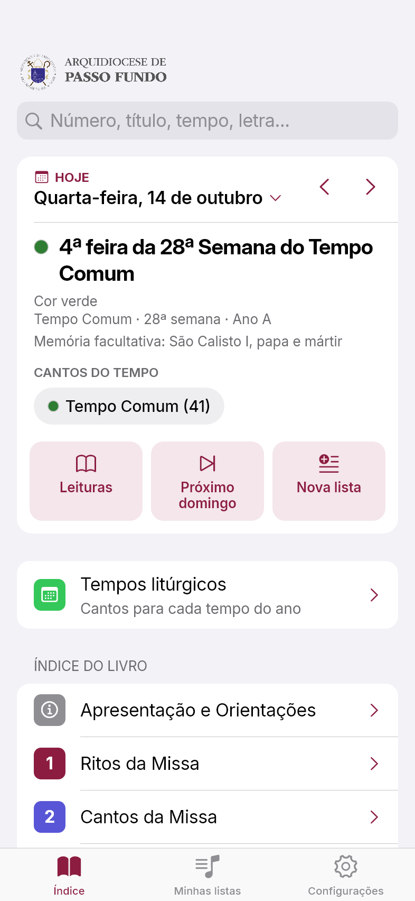
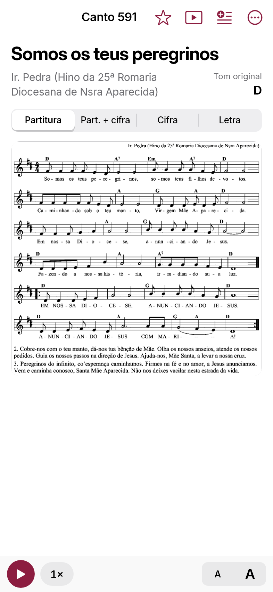
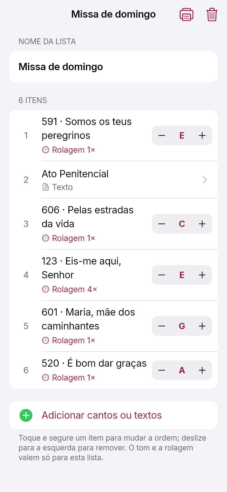
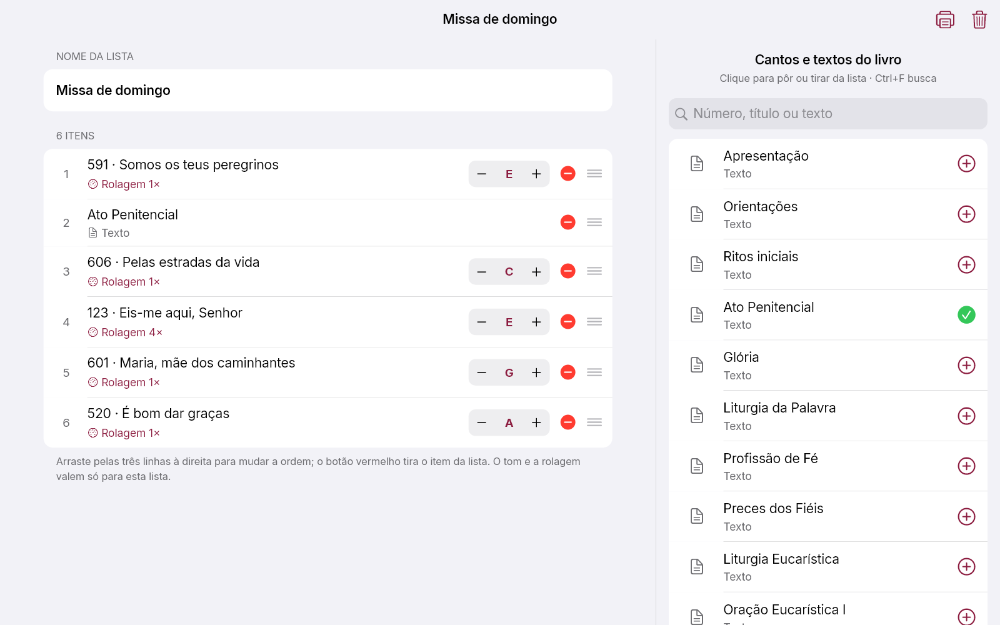

  <picture>
    <source media="(prefers-color-scheme: dark)" srcset="imagens/logo_escuro.png">
    
  </picture>

<h1 align="center">Aleluia! Cantos e Orações</h1>

  O livro de cantos da Arquidiocese de Passo Fundo no celular e no computador: 
  partituras, cifras, letras, orações e a liturgia do dia — tudo funcionando sem internet.

  
  &nbsp;
  

  
    Android 7 ou mais novo · Windows 10 ou 11 (64 bits) · Gratuito 
    Links diretos: <a href="https://github.com/AlexandreKovaleski/aleluia-app/releases/latest/download/Aleluia.apk">Aleluia.apk</a> ·
    <a href="https://github.com/AlexandreKovaleski/aleluia-app/releases/latest/download/Aleluia-Instalador.exe">Aleluia-Instalador.exe</a> ·
    <a href="https://github.com/AlexandreKovaleski/aleluia-app/releases">todas as versões</a>
  

  
  
  
  

---

## ✨ O que o app faz

### 📖 O livro inteiro na mão
- **Mais de 770 cantos** com partitura, cifra e letra, e os **ritos da missa e orações** do livro.
- **Índice igual ao do livro**, por partes da missa e por tempos litúrgicos.
- **Busca** por número, título, tempo litúrgico ou qualquer trecho da letra.
- **Favoritos** com a estrela, para achar rápido os cantos mais usados.

### 🎼 Quatro formas de ver cada canto
| Forma | O que mostra |
|---|---|
| **Partitura** | A partitura como no livro, com as notas |
| **Part. + cifra** | A partitura com os acordes e as demais estrofes cifradas |
| **Cifra** | A letra com os acordes em cima de cada sílaba — e aqui dá para **mudar o tom** |
| **Letra** | Só o texto, grande e limpo, para quem canta |

Mude o tom com um toque: o app transpõe todos os acordes e guarda o tom escolhido para aquele canto.

### 📅 A liturgia do dia
- O **dia litúrgico** de hoje: tempo, semana, cor e as celebrações (solenidades, festas e memórias).
- As **leituras da missa** (Lecionário, tradução oficial da CNBB), guardadas no aparelho: abrem sem internet, na igreja.
- Os **cantos do tempo** litúrgico e um atalho para o **próximo domingo**.

### 📝 Listas para a missa e o ensaio
- Monte a lista da celebração com **cantos e textos**, na ordem, com o **tom** e a **velocidade de rolagem** de cada canto.
- **Compartilhe pelo WhatsApp**: quem recebe copia a mensagem e toca em **Importar** — a lista chega igualzinha, com os tons.
- Durante a missa, passe de um canto para o outro **deslizando** ou com os botões.

### 🎹 Feito para quem toca
- **Rolagem automática**, com velocidades diferentes por canto.
- **Pedal Bluetooth**: um pedal vira a página, sem tirar as mãos do instrumento.
- **Tela sempre acesa** enquanto o app está aberto.
- **Tamanho da letra**, **cores** da cifra e da letra e **modo noturno**.
- **Vídeo-aulas** de centenas de cantos, no canal da Arquidiocese.

### 🖨️ Imprimir
- Um **canto** — partitura, partitura com cifras, cifra no tom escolhido ou letra.
- A **lista inteira**, cada canto começando numa folha nova, numerado na ordem da lista.

### ➕ E mais
- **Cantos adicionados**: cadastre cantos que não estão no livro (com a cifra) e use-os nas listas.
- **Atualizações automáticas** de cantos, partituras e leituras, sem reinstalar o app.
- **Relatar problema**: achou um erro numa cifra ou letra? Toque em **⋯ → Reportar problema** e a mensagem vai pronta para a equipe pelo WhatsApp.

### 💻 No computador (Windows)
Tudo o que o app do celular faz, com mouse e teclado. Em janela grande, a tela da lista mostra **os cantos do livro numa coluna ao lado**: um clique põe ou tira o canto da lista.

  

---

## 📲 Como instalar no Android

1. **No celular**, toque no botão **[Baixar para Android](https://github.com/AlexandreKovaleski/aleluia-app/releases/latest/download/Aleluia.apk)**. O arquivo `Aleluia.apk` começa a baixar.
   - Se o navegador avisar que *"este tipo de arquivo pode ser perigoso"*, toque em **Baixar mesmo assim**.
2. Quando o download terminar, toque em **Abrir**. Se o aviso já sumiu, abra o app **Arquivos** (ou **Downloads**) e toque em `Aleluia.apk`.
3. Na primeira vez, o Android pede licença para instalar apps baixados pelo navegador:
   toque em **Configurações**, ligue **Permitir desta fonte** e volte.
4. Toque em **Instalar**.
   - Se aparecer um aviso do **Play Protect**, toque em **Mais detalhes → Instalar mesmo assim**.
   - Em celulares **Xiaomi**, a verificação de segurança pode pedir para esperar alguns segundos antes de liberar o botão **Instalar**.
5. Pronto! Toque em **Abrir** — ou procure o ícone **Aleluia!** na tela do celular.

> **Para atualizar o app**, é só baixar e instalar de novo pelo mesmo botão. Ele é instalado por cima e **suas listas, favoritos e tons continuam lá**.
> Os cantos, partituras e leituras se atualizam sozinhos, pela internet, sem precisar reinstalar.

---

## 🪟 Como instalar no Windows

1. **No computador**, clique em **[Baixar para Windows](https://github.com/AlexandreKovaleski/aleluia-app/releases/latest/download/Aleluia-Instalador.exe)**. O arquivo `Aleluia-Instalador.exe` vai para a pasta **Downloads**.
   - Se o navegador disser que o arquivo *"não é baixado com frequência"*, clique em **⋯ → Manter → Manter mesmo assim**.
2. Abra o `Aleluia-Instalador.exe`.
3. O Windows pode mostrar a tela azul **"O Windows protegeu o computador"** — é porque o programa é novo e ainda não tem assinatura digital paga.
   Clique em **Mais informações** e depois em **Executar assim mesmo**.
4. No instalador, marque se quer um atalho na **área de trabalho**, clique em **Instalar** e depois em **Concluir**. O app abre em seguida.
5. Depois, é só procurar **Aleluia** no **menu Iniciar**.

> Não precisa de senha de administrador: o app é instalado só para o seu usuário do Windows.
> **Para atualizar**, baixe e rode o instalador novo — ele substitui a versão anterior e mantém suas listas.
> **Para desinstalar**: Configurações → Aplicativos → Aplicativos instalados → **Aleluia! Cantos e Orações** → Desinstalar.

### ⌨️ Atalhos no computador
| Tecla | O que faz |
|---|---|
| <kbd>Ctrl</kbd> + <kbd>F</kbd> | Busca na coluna de cantos, ao montar uma lista |
| <kbd>Ctrl</kbd> + <kbd>P</kbd> | Imprime o canto ou a lista aberta |
| <kbd>→</kbd> ou <kbd>Page Down</kbd> | Desce a tela; no fim do canto, vai para o próximo (como o pedal) |
| <kbd>←</kbd> ou <kbd>Page Up</kbd> | Sobe a tela; no começo, volta para o anterior |
| Botão direito do mouse | Numa lista: compartilhar, copiar, imprimir, duplicar ou excluir. Numa linha da cifra: relatar um erro naquela linha |

---

## 🔄 Celular ⇄ computador

Cada aparelho guarda as suas próprias listas. Para levar uma lista de um para o outro:

1. Na tela **Minhas listas**, toque e segure (no computador, clique com o botão direito) na lista e escolha **Compartilhar** ou **Copiar mensagem**.
2. Envie a mensagem pelo **WhatsApp** (no computador, pelo WhatsApp Web ou o do Windows).
3. No outro aparelho, copie a mensagem inteira e toque em **Importar** (o ícone ao lado do **+** em Minhas listas).

---

## ❓ Dúvidas e problemas

- **Erro numa cifra, letra ou partitura?** Abra o canto e use **⋯ → Reportar problema**. Na cifra, toque e segure a linha errada para já mandar qual é.
- **O app não abre o canto que acabou de ser corrigido?** Vá em **Configurações → Atualizações → Verificar agora**.
- **Não consigo instalar no celular?** Confira se o Android é a versão 7 ou mais nova e se a opção **Permitir desta fonte** foi ligada para o navegador usado no download.

   
  Aleluia! Cantos e Orações · Arquidiocese de Passo Fundo

